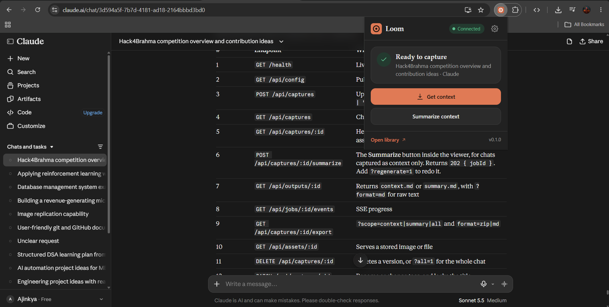
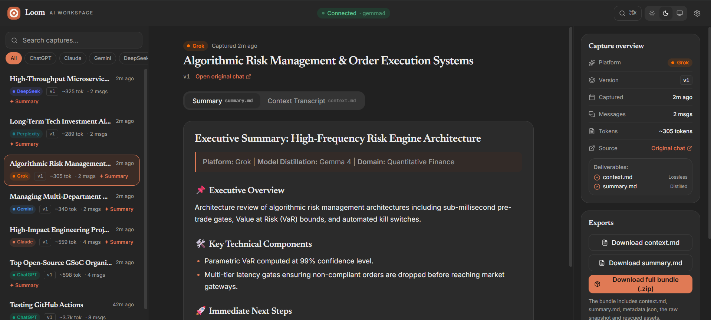
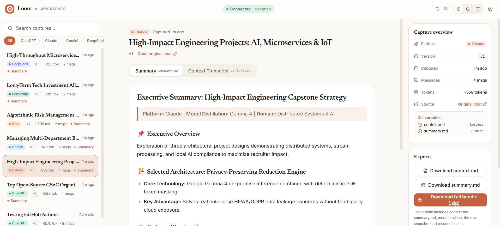
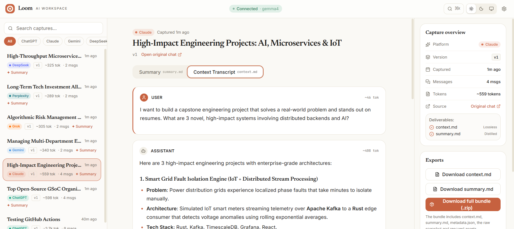
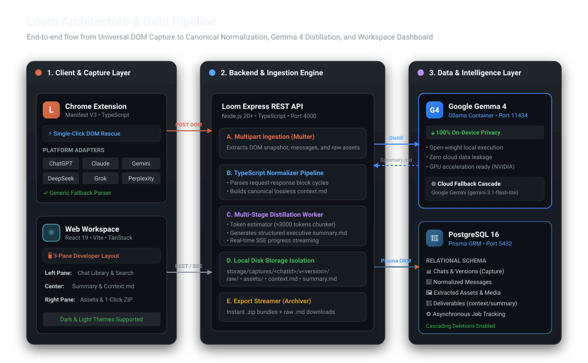

#  <span style="color: #ffffff; font-weight: 800;">Loom</span> &nbsp;<span style="font-size: 18px; font-weight: 400; color: #cbd5e1;">— Universal AI Chat Context Rescuer, Normalizer &amp; Gemma 4 Distillation Workspace</span>

[](https://github.com/Ajinkya-909/Loom)
[](https://www.mlh.com/partners/gemma)
[](https://ai.google.dev/gemma)
[](https://www.postgresql.org/)
[](https://www.docker.com/)
[](https://react.dev/)

**🏆 Built for Hacktoberfest Hack Day Pune 2026 — Team Hack4Brahma**  
*Track: Open-Source AI Challenge • Domain: Developer Tools & Productivity*

Loom eliminates AI conversation fragmentation across **ChatGPT, Claude, Gemini, DeepSeek, Grok, and Perplexity**. It rescues conversational DOMs directly from active browser tabs, normalizes them into canonical `context.md`, and leverages on-device **Google Gemma 4** to distill actionable executive summaries (`summary.md`) with zero cloud data exposure.

[🚀 Quickstart](#-quickstart-guide) • [📸 Product Tour](#-application-preview--product-tour) • [🎯 Problem Statement](#-the-problem-why-developers-need-loom) • [🤖 Gemma 4 Integration](#-why-gemma-4-open-source-ai-challenge) • [🏛️ System Architecture](#-system-architecture--how-it-works) • [💻 Local Setup](#-developer-guide--local-setup)

---

## 📸 Application Preview & Product Tour

Experience the Loom developer experience across browser tabs, dark mode, and light mode:

<div align="center">

### 1. Universal Browser Extension (Manifest V3)
*Instant 1-click capture running directly inside active Claude, ChatGPT, Gemini, or DeepSeek tabs*



<br/><br/>

### 2. 3-Pane Web Workspace (Dark Theme)
*Searchable Chat Library with platform tags, Gemma 4 distillation viewer, and 1-click bundle downloads*



<br/><br/>

### 3. Light Theme — Executive Summary (`summary.md`)
*Structured distillation synthesizing core objectives, architecture designs, and actionable milestones*



<br/><br/>

### 4. Canonical Context Transcript (`context.md`)
*Granular request-response cycle view with per-turn token estimations, syntax-highlighted code blocks, and media references*



</div>

---

## 🎯 The Problem: Why Developers Need Loom

Modern software engineering and learning have become **multi-model workflows**. Developers, students, and researchers rarely stick to a single AI assistant:
- **Claude** is used for nuanced architectural reasoning and code reviews.
- **ChatGPT** is used for boilerplate generation and library discovery.
- **Google Gemini** is used for multimodal reasoning and large-context document analysis.
- **DeepSeek & Grok** are used for algorithmic optimization, finance, and mathematical reasoning.
- **Perplexity** is used for cited technical documentation search.

However, this multi-model reality creates severe friction:

### 1. The Context Silo & Tab Explosion
Critical architectural decisions, debugging breakthroughs, and code snippets remain trapped in disconnected browser tabs across completely different platform accounts. Within days, developers lose track of which conversation solved which problem.

### 2. The "Manual Copy-Paste Tax" & Lossy Sharing
Passing context from ChatGPT into Claude or a teammate's IDE requires tedious manual copy-pasting. Code fences break, formatted tables collapse into unreadable text, and embedded diagrams are permanently lost.

### 3. Link Rot & Data Privacy Leaks
Native platform "Share Links" are fragile:
- They frequently expire, break, or stop rendering when models update.
- They lack granular control: sharing a link often exposes 40 irrelevant exploratory messages just to share 1 solution.
- Proprietary code, API tokens, and confidential schemas are exposed to public third-party link indexing.

### 4. Noise & Information Overload (Especially for Beginners)
A 30-turn debugging session contains massive trial-and-error noise. Beginners get overwhelmed trying to decipher the final answer. What developers actually need is:
- A canonical, normalized version of the transcript (`context.md`).
- A clean, actionable executive summary (`summary.md`) detailing: *What was decided? What code was finalized? What are the next steps?*

---

## 💡 How Loom Solves the Problem

Loom introduces an end-to-end pipeline that rescues, normalizes, distills, and organizes AI chat conversations into a unified, searchable developer hub:

- **Zero-Loss Context Capture**: Direct DOM extraction preserves conversational hierarchy, code blocks, tables, and media.
- **Canonical Normalization**: Cleans up platform quirks into standard Markdown (`context.md`) ready for any IDE, local LLM, or teammate.
- **Privacy-Preserving Distillation**: Runs **Google Gemma 4 locally on-device**, ensuring proprietary code and private discussions never leave your machine.
- **Instant Portable Bundles**: 1-click export for raw `context.md`, distilled `summary.md`, or a complete `.zip` bundle with all Markdown and rescued assets.

---

## 🤖 Why Gemma 4? (Open-Source AI Challenge)

Under the **Hacktoberfest Hack Day Pune 2026 Open-Source AI Challenge**, projects must demonstrate meaningful integration of open-weight models. Loom places **Google Gemma 4** at the foundational core of its intelligence layer:

- **100% On-Device Privacy**: Developers routinely paste database schemas, environment variables, and proprietary algorithms into chat sessions. Gemma 4 runs inside a local Docker container (via Ollama)—guaranteeing that sensitive data is distilled with **zero cloud exposure**.
- **Multi-Stage Chunking Architecture**: For long transcripts exceeding prompt limits (>3000 tokens), Loom's pipeline breaks the conversation into chronological request-response pairs, processes them sequentially through Gemma 4, and synthesizes a unified executive summary.
- **Deterministic Technical Schema**: Gemma 4 is prompted with a strict technical specification, producing structured Markdown (`summary.md`) detailing Executive Overview, Core Decisions, Code Highlights, and Action Items.
- **Resilient Dual-Engine Cascade**: When running on systems without dedicated GPUs, Loom includes a seamless, automatic fallback to **Google Gemini** (`gemini-3.1-flash-lite`), ensuring background jobs never fail.

---

## 🏛️ System Architecture: How It Works

<div align="center">
  
</div>

<br/>

<details>
<summary><b>🔍 Pipeline &amp; Frontend Component Breakdown</b></summary>
<br/>

- **Extension (DOM Capture)**: Manifest V3 content script extracting isolated DOM trees, code blocks, and media from ChatGPT, Claude, Gemini, Grok, Perplexity, and DeepSeek tabs.
- **Backend (Normalizer Engine)**: Express.js pipeline compiling heterogeneous DOMs into standard `context.md` with SHA-256 deduplication and local disk storage isolation.
- **AI Worker (Gemma 4 Distillation)**: Background worker managing prompt chunking and executing local Ollama inference to generate structured `summary.md`.
- **Frontend Workspace**: React 19 / Vite 3-pane dashboard featuring split-second search, PrismJS syntax highlighting, dark/light themes, and 1-click ZIP streaming.

</details>

---

## 🛠️ Technology Stack

| Layer | Stack | Key Highlights |
| :--- | :--- | :--- |
| **Frontend** | React 19, TypeScript, Vite, TailwindCSS | 3-pane dashboard, Dark/Light themes, PrismJS syntax highlighting |
| **Extension** | Chrome Manifest V3, Content Scripts | 1-click DOM capture for ChatGPT, Claude, Gemini, Grok, DeepSeek |
| **Backend** | Node.js 20+, Express.js, Multer, Cheerio | Canonical normalizer, SHA-256 deduplication, ZIP archive streaming |
| **AI Engine** | **Google Gemma 4** (Ollama) + Gemini Fallback | On-device private distillation, >3k token chunking architecture |
| **Database** | PostgreSQL 16 + Prisma ORM | Cascading relational schema, foreign keys, UUID indexing |
| **DevOps** | Docker, Docker Compose | 1-command deployment (`docker compose up --build`), Alpine builds |

---

## 🚀 Quickstart Guide

Get the complete Loom ecosystem running in under 2 minutes using Docker.

### Prerequisites
- [Docker](https://www.docker.com/) and [Docker Compose](https://docs.docker.com/compose/) installed
- [Google Chrome](https://www.google.com/chrome/) (to install the browser extension)
- *(Optional)* NVIDIA GPU with [NVIDIA Container Toolkit](https://docs.nvidia.com/datacenter/cloud-native/container-toolkit/install-guide.html) for fast Gemma 4 inference

### 1. Clone the Repository
```bash
git clone https://github.com/Ajinkya-909/Loom.git
cd Loom
```

### 2. Configure Environment Variables
Copy the preconfigured environment template:
```bash
cp .env.example .env
```
*(The `.env` file comes preconfigured with default database credentials, ports, Gemma 4 defaults, and a fallback Gemini key).*

### 3. Launch Services with Docker Compose
```bash
docker compose up --build
```

This single command orchestrates:
- 🐘 **PostgreSQL 16**: `localhost:5432`
- ⚙️ **Loom Backend API**: `http://localhost:4000` (Healthcheck: `http://localhost:4000/health`)
- 💻 **Loom Web Workspace**: `http://localhost:8080`
- 🤖 **Gemma 4 Model Server (Ollama)**: `http://localhost:11434`

---

## 🧩 Installing the Chrome Extension

1. Open Google Chrome and go to `chrome://extensions/`.
2. Toggle on **Developer mode** in the upper-right corner.
3. Click **Load unpacked**.
4. Select the `extension/` folder inside this repository.
5. The **Loom** icon will appear in your Chrome toolbar.
6. Open any conversation on [ChatGPT](https://chatgpt.com), [Claude](https://claude.ai), [Gemini](https://gemini.google.com), or [Grok](https://grok.com/) and click the Loom extension icon to capture or summarize!

---

## 💻 Developer Guide & Local Setup

If you prefer developing outside Docker:

### 1. Database Setup
Ensure PostgreSQL is running locally on port 5432:
```bash
cd backend
npx prisma generate
npx prisma db push
```

### 2. Start the Backend API
```bash
cd backend
npm install
npm run dev
# Backend API runs at http://localhost:4000
```

### 3. Start the Frontend Workspace
```bash
cd frontend
npm install
npm run dev
# Frontend runs at http://localhost:8080
```

---

## 🌱 Demo & Presentation Scripts

### Instant Database Seeding (Populate 6 Real Multi-Platform Chats)
To immediately populate your local workspace with 6 realistic, multi-platform chats (ChatGPT, Claude, Gemini, Grok, Perplexity, DeepSeek) complete with syntax-highlighted code blocks, tables, and Gemma 4 summaries:

```bash
cd backend
npm run db:seed
```
*Alternatively, from the repository root:*
```bash
npm --prefix backend run db:seed
```

### Instant Database Reset (Clean Slate for Live Demos)
Before live presentations, you can wipe all captured test chats, background jobs, and stored media files to restore a clean workspace:

```bash
cd backend
npm run db:reset
```
*Alternatively, from the repository root:*
```bash
npm --prefix backend run db:reset
```

---

## 📁 Repository Structure

```
Loom/
├── assets/                    # Project logos, screenshots, and README media
│   ├── logo.png               # Official Loom brand logo
│   ├── extension-popup-claude.png # Browser extension popup in Claude
│   ├── workspace-dark-summary.png # 3-Pane Web Workspace in Dark Theme
│   ├── workspace-light-summary.png# Light Theme Executive Summary view
│   └── workspace-light-transcript.png # Canonical Context Transcript view
├── backend/                   # Express.js REST API & Ingestion Engine
│   ├── prisma/                # Prisma ORM schema & migrations
│   ├── scripts/               # Seed (db:seed) & Reset (db:reset) utilities
│   ├── src/
│   │   ├── controllers/       # Captures, Chats, Export, Config controllers
│   │   ├── pipeline/          # Normalizer & Gemma 4 Summarizer pipelines
│   │   ├── utils/             # Gemma 4 Ollama & Gemini fallback client
│   │   └── server.ts          # Express application entrypoint
│   └── storage/               # Physical storage for raw DOMs, assets, & markdown
├── docs/                      # Architectural & API specifications
│   ├── API_SPECIFICATION.md   # Complete REST API documentation
│   ├── DATABASE_SCHEMA.md     # PostgreSQL relational schema docs
│   └── PRODUCT_SPEC.md        # Product architecture & requirements
├── extension/                 # Manifest V3 Chrome Extension
│   ├── src/
│   │   ├── content/           # DOM extraction adapters for ChatGPT, Claude, etc.
│   │   ├── popup/             # 2-button capture UI & settings handshake
│   │   └── background/        # Service worker & API dispatcher
│   └── manifest.json          # Chrome Extension Manifest V3
├── frontend/                  # React 19 / Vite Web Workspace Dashboard
│   ├── src/
│   │   ├── components/        # 3-Pane UI (LeftPane, CenterPane, RightPane)
│   │   ├── routes/            # Route tree (/ & /c/$id)
│   │   └── lib/               # API clients, store, & markdown renderer
│   └── Dockerfile             # Multi-stage production container build
├── docker-compose.yml         # Multi-service orchestration (Postgres, Backend, Frontend, Gemma 4)
└── README.md                  # Comprehensive Hacktoberfest submission documentation
```

---

## 👥 Team & Submission Details

- **Event**: Hacktoberfest Hack Day Pune 2026
- **Organizer**: Team Hack4Brahma
- **Track**: Open-Source AI Challenge — Powered by Gemma 4
- **Lead Developer**: [Ajinkya Deshmukh](https://github.com/Ajinkya-909)
- **License**: MIT Open Source License

---

<div align="center">
  <b>Built with ❤️ for Hacktoberfest Hack Day Pune 2026</b><br/>
  <i>Empowering developers to rescue, normalize, and distill fragmented AI conversations with open-source AI.</i>
</div>