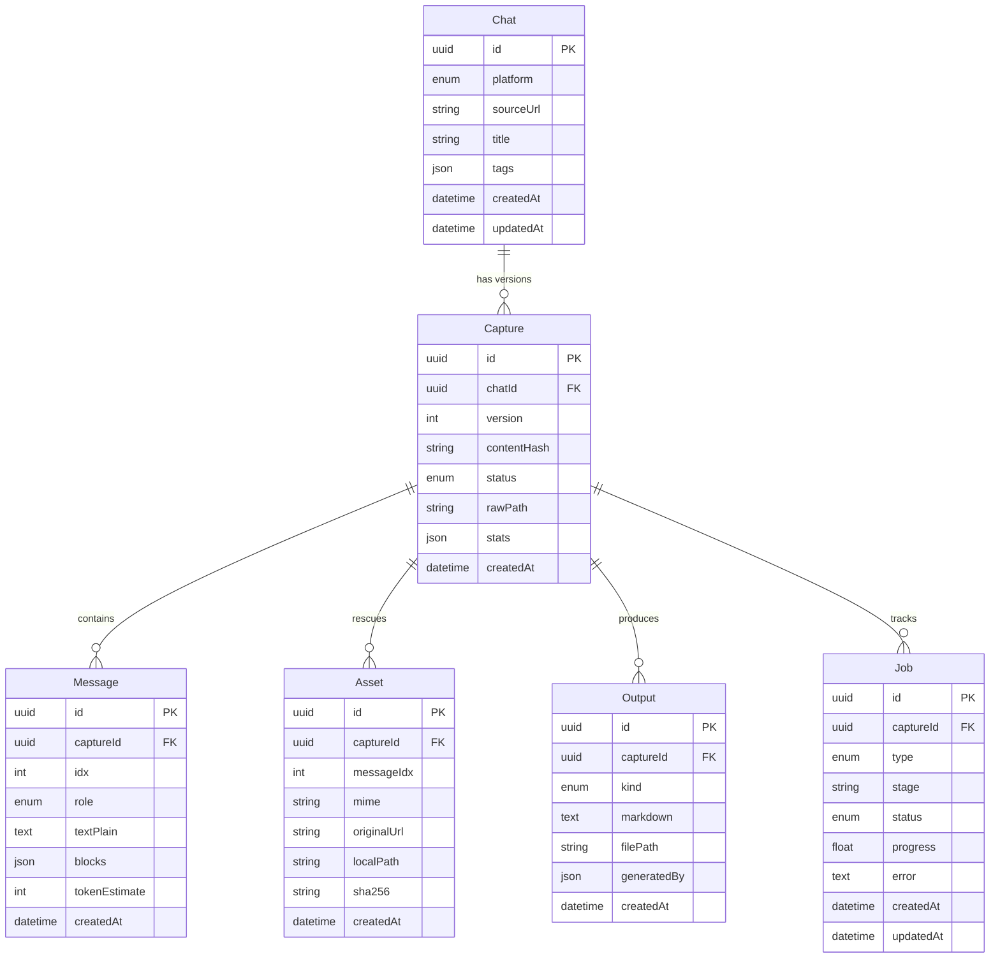

# DATABASE & STORAGE SPECIFICATION: LOOM

> **Status:** Finalized & Ready for Implementation  
> **ORM:** Prisma (PostgreSQL 16)  
> **Storage Strategy:** Disk/Volume-backed hybrid model (PostgreSQL for metadata & relationships; local disk storage for files, assets, and markdown outputs).

---

## 1. Context Preservation Guarantee (Tables, Charts & Rich Elements)

A primary concern in developer context sharing is **zero information loss**:
* **Markdown Tables**: When an LLM outputs tables, the parser captures the exact Markdown table structure (`| Header 1 | Header 2 | ...`). Both human readers in the web viewer and downstream LLMs reading `context.md` receive 100% of the tabular data.
* **Diagrams & Charts**:
  * **Mermaid / ASCII Diagrams**: Preserved directly as ` ```mermaid ` or code blocks inside `Message.blocks` and `context.md`.
  * **Rendered Image Charts / Canvas**: Rescued by the extension as binary images/SVGs, saved to `assets/`, recorded in the `assets` table, and embedded cleanly in `context.md` as ``.
* **Code Blocks**: Preserved with syntax language tags (`ts`, `python`, `sql`, etc.) and exact line breaks.

Nothing is truncated or stripped down to lossy plain strings.

---

## 2. Entity Relationship Diagram (ERD)



---

## 3. Enumerations (Strict State Machine)

To guarantee type safety across the database, backend, and frontend TypeScript contracts:

### `Platform`
Supported chat providers:
* `CHATGPT`
* `CLAUDE`
* `GEMINI`
* `DEEPSEEK`
* `PERPLEXITY`
* `GENERIC` (Fallback DOM parser)

### `CaptureStatus`
Lifecycle of a captured version:
* `QUEUED` (Payload received, waiting in queue)
* `PROCESSING` (Normalizing DOM and generating context)
* `READY` (Context generated, outputs available)
* `FAILED` (Encountered unrecoverable ingestion error)

### `MessageRole`
Participant in the request-response cycle:
* `USER` (Developer prompts and queries)
* `ASSISTANT` (AI responses, tables, code outputs)
* `SYSTEM` (System prompts or error notices)

### `OutputKind`
Types of generated markdown documents:
* `CONTEXT` (`context.md` - Raw canonical request-response cycle)
* `SUMMARY` (`summary.md` - Gemma distilled context, decisions, code deliverables)

### `JobType`
Background pipeline job operations:
* `INGEST_AND_NORMALIZE` (DOM extraction -> `context.md`)
* `SUMMARIZE` (Gemma prompt execution -> `summary.md`)

### `JobStatus`
Progress state for background workers:
* `PENDING`
* `RUNNING`
* `COMPLETED`
* `FAILED`

---

## 4. Detailed Table Schema Definitions

### 4.1 `chats` Table
Represents an ongoing chat thread across multiple visits and saves.

| Column | Type | Constraints | Description |
|---|---|---|---|
| `id` | `UUID` | `@id @default(uuid())` | Primary key |
| `platform` | `Platform` | `NOT NULL` | Chat platform enum |
| `sourceUrl` | `VARCHAR(1024)` | `NOT NULL` | Original URL of the chat tab |
| `title` | `VARCHAR(255)` | `NOT NULL` | Conversation title |
| `tags` | `JSONB` | `@default("[]")` | User/system categorization tags |
| `createdAt` | `TIMESTAMP` | `@default(now())` | Creation timestamp |
| `updatedAt` | `TIMESTAMP` | `@updatedAt` | Last modification timestamp |

* **Indexes**:
  * `@@index([sourceUrl])`: Fast lookup when user clicks extension on an existing chat URL.
  * `@@index([platform])`: Filter library by platform.

---

### 4.2 `captures` Table
Represents an immutable point-in-time snapshot of a chat.

| Column | Type | Constraints | Description |
|---|---|---|---|
| `id` | `UUID` | `@id @default(uuid())` | Primary key |
| `chatId` | `UUID` | `FK -> chats.id ON DELETE CASCADE` | Parent chat reference |
| `version` | `INT` | `NOT NULL @default(1)` | Incremental version number (v1, v2, etc.) |
| `contentHash` | `VARCHAR(64)` | `NOT NULL` | SHA-256 hash of messages (deduplication) |
| `status` | `CaptureStatus` | `@default(QUEUED)` | Current processing status |
| `rawPath` | `VARCHAR(512)` | `NOT NULL` | Relative path to raw storage folder |
| `stats` | `JSONB` | `@default("{}")` | Metadata: message counts, code block count, etc. |
| `createdAt` | `TIMESTAMP` | `@default(now())` | Capture timestamp |

* **Indexes**:
  * `@@index([chatId, version])`: Fast fetch for the latest version.
  * `@@index([contentHash])`: Deduplication check before creating a new capture.

---

### 4.3 `messages` Table
Structured breakdown of individual prompt-response pairs.

| Column | Type | Constraints | Description |
|---|---|---|---|
| `id` | `UUID` | `@id @default(uuid())` | Primary key |
| `captureId` | `UUID` | `FK -> captures.id ON DELETE CASCADE` | Associated capture snapshot |
| `idx` | `INT` | `NOT NULL` | 0-based sequential ordering index |
| `role` | `MessageRole` | `NOT NULL` | USER, ASSISTANT, or SYSTEM |
| `textPlain` | `TEXT` | `NOT NULL` | Clean text for full-text search & previews |
| `blocks` | `JSONB` | `NOT NULL @default("[]")` | Structured blocks (code with lang, text, tables, diagrams) |
| `tokenEstimate`| `INT` | `@default(0)` | Estimated token count |
| `createdAt` | `TIMESTAMP` | `@default(now())` | Record timestamp |

* **Indexes**:
  * `@@index([captureId, idx])`: Sequential retrieval for transcript rendering.

---

### 4.4 `assets` Table
Tracks images, charts, and attachments rescued from the browser session.

| Column | Type | Constraints | Description |
|---|---|---|---|
| `id` | `UUID` | `@id @default(uuid())` | Primary key |
| `captureId` | `UUID` | `FK -> captures.id ON DELETE CASCADE` | Associated capture snapshot |
| `messageIdx` | `INT` | `NOT NULL` | Index of the message containing this asset |
| `mime` | `VARCHAR(100)` | `NOT NULL` | MIME type (e.g. `image/png`, `image/svg+xml`) |
| `originalUrl` | `TEXT` | `NULLABLE` | Original CDN URL from the AI provider |
| `localPath` | `VARCHAR(512)` | `NOT NULL` | Relative path inside `storage/captures/.../assets/` |
| `sha256` | `VARCHAR(64)` | `NOT NULL` | Asset file integrity hash |
| `createdAt` | `TIMESTAMP` | `@default(now())` | Saved timestamp |

* **Indexes**:
  * `@@index([captureId])`: Retrieve all assets for a capture.

---

### 4.5 `outputs` Table
Stores generated markdown deliverables (`context.md` and `summary.md`).

| Column | Type | Constraints | Description |
|---|---|---|---|
| `id` | `UUID` | `@id @default(uuid())` | Primary key |
| `captureId` | `UUID` | `FK -> captures.id ON DELETE CASCADE` | Associated capture snapshot |
| `kind` | `OutputKind` | `NOT NULL` | `CONTEXT` or `SUMMARY` |
| `markdown` | `TEXT` | `NOT NULL` | Raw markdown content for immediate UI display |
| `filePath` | `VARCHAR(512)` | `NOT NULL` | Relative path to the `.md` file on disk |
| `generatedBy` | `JSONB` | `@default("{}")` | Generator metadata (model name, prompt version) |
| `createdAt` | `TIMESTAMP` | `@default(now())` | Generation timestamp |

* **Indexes**:
  * `@@index([captureId, kind])`: Instant retrieval for web workspace tabs.

---

### 4.6 `jobs` Table
Asynchronous execution tracker for UI progress feedback (SSE stream).

| Column | Type | Constraints | Description |
|---|---|---|---|
| `id` | `UUID` | `@id @default(uuid())` | Primary key |
| `captureId` | `UUID` | `FK -> captures.id ON DELETE CASCADE` | Associated capture snapshot |
| `type` | `JobType` | `NOT NULL` | INGEST_AND_NORMALIZE or SUMMARIZE |
| `stage` | `VARCHAR(50)` | `NOT NULL @default("queued")` | Active stage label |
| `status` | `JobStatus` | `@default(PENDING)` | Current status enum |
| `progress` | `FLOAT` | `@default(0.0)` | Progress percentage (0.0 to 1.0) |
| `error` | `TEXT` | `NULLABLE` | Failure message if job fails |
| `createdAt` | `TIMESTAMP` | `@default(now())` | Queued timestamp |
| `updatedAt` | `TIMESTAMP` | `@updatedAt` | Last progress heartbeat |

* **Indexes**:
  * `@@index([captureId])`: Poll or stream progress for an active capture.

---

## 5. Storage Directory Layout Mapping

The database columns (`rawPath`, `localPath`, `filePath`) directly correlate to the disk storage layout:

```text
backend/storage/
└── captures/
    └── {Chat.id}/
        └── v{Capture.version}/
            ├── raw/                          <-- Capture.rawPath
            │   ├── snapshot.html
            │   └── messages.json
            ├── assets/
            │   ├── {Asset.id}.png            <-- Asset.localPath
            │   └── {Asset.id}.svg
            ├── context.md                    <-- Output(kind=CONTEXT).filePath
            └── summary.md                    <-- Output(kind=SUMMARY).filePath
```

---

## 6. Cascading Deletion Strategy

When a user deletes a `Chat`:
1. PostgreSQL cascading delete (`ON DELETE CASCADE`) automatically removes all related rows in `captures`, `messages`, `assets`, `outputs`, and `jobs` in a single atomic transaction.
2. The backend filesystem handler triggers a cleanup task that deletes the folder `storage/captures/{Chat.id}/`.
